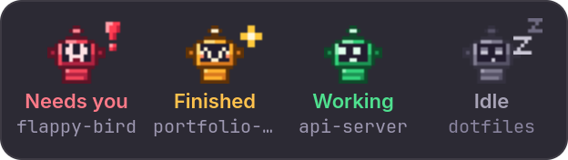
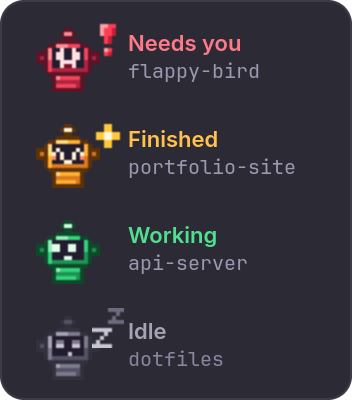

# claude-session-bots

A small pixel-art widget for Linux (Wayland). Each running Claude Code session
is a robot in a screen corner. Its colour, face and small indicator show what
that session is doing, so you don't have to check every terminal.

| State | Meaning |
|---|---|
| **Needs you** (red, "!") | Claude is blocked: permission prompt, question, or the turn failed |
| **Finished** (orange, sparkle) | The turn finished and you haven't looked yet |
| **Working** (green, bouncing) | Claude is thinking or running tools |
| **Idle** (grey, "zz") | Session open, nothing new |





Hover a robot for details. Left-click a Finished robot to mark it as seen (it turns
Idle); clicks on other robots do nothing. Right-click for options. Desktop notifications are **off by default**; turn them on with the
**Notifications** switch in the right-click menu.

The spec is in `design/DESIGN.md`. Sprites are in `design/` and generated from
`design/sprites.py`.

## Requirements

Fedora, Wayland. Niri is the main target. GNOME runs the widget as a normal
undecorated window (no corner placement).

```
sudo dnf install gtk4-layer-shell python3-gobject gtk4 rsms-inter-fonts jetbrains-mono-fonts
```

Python 3 with PyGObject and GTK 4. The fonts are optional; the widget falls back
to other fonts.

### GNOME and other desktops without layer-shell

Without gtk4-layer-shell, or on a desktop that doesn't support it (GNOME), the
widget runs as an undecorated normal window:

- Press and hold anywhere on the panel, then drag, to move it.
- Keep it above other windows with Alt+Space, then **Always on Top**. The first
  tooltip shows this hint once.
- The corner placement and "Move to corner" are unavailable.

To test this path on Niri: `bin/claude-session-bots --demo --no-layer-shell`.

## Ubuntu

Ubuntu 24.10 or newer is needed for gtk4-layer-shell. Older releases still run
the widget, as a normal window.

```
sudo apt install python3-venv python3-gi gir1.2-gtk-4.0 gir1.2-gtk4layershell-1.0 \
  libgtk4-layer-shell0 fonts-inter fonts-jetbrains-mono
```

Then set up the project the same way as above (`python3 -m venv --system-site-packages .venv`).
On GNOME the widget runs as a normal window (see above). On a Niri or other
layer-shell session it works the same as on Fedora.

The launcher looks for the library in `/usr/lib64`, `/usr/lib/x86_64-linux-gnu`
and `/usr/lib/aarch64-linux-gnu`, then uses `ldconfig`. If it is missing, it prints
the install command and still starts the widget as a normal window.

## Setup

```
python3 -m venv --system-site-packages .venv
.venv/bin/pip install pytest        # only needed to run the tests
```

## Quick commands

The widget normally starts by itself at login (see Autostart below). The `bots`
command is mainly for starting it again after you stopped it, or restarting it after an update.

```
bots() { systemctl --user "${1:-start}" claude-session-bots; }
```

- `bots` starts the widget
- `bots stop` stops it
- `bots restart` restarts it after an update
- `bots status` shows whether it's running

To add it, run `python3 scripts/install.py --shell-shortcut`. It appends the function to
`~/.bashrc`, or to `~/.zshrc` if your shell is zsh. If a `bots` function or alias already
exists, it says so and changes nothing. You can also paste the line above into that file yourself.
Open a new terminal afterwards, or run `source ~/.bashrc` (or `~/.zshrc`).

## Run the demo (no Claude Code needed)

```
bin/claude-session-bots --demo
```

Four fake sessions cycle through the states. Demo mode never sends notifications.

## Check the sessions from the terminal

```
bin/claude-session-bots --list
```

Prints the sessions the widget currently sees (project, state, since), oldest first.
Sessions whose Claude process has exited are left out.

## Install the Claude Code hooks

The hook script writes one state file per session. It is registered in your
user settings as async hooks, so it covers every project. The installer is a
dry run by default:

```
python3 scripts/install.py            # show the change, write nothing
python3 scripts/install.py --apply    # back up ~/.claude/settings.json, then merge
```

Only entries that point at `session_hook.py` are added or removed. Your other
settings and hooks are kept. A backup `settings.json.bak-<time>` is written
before each change.

Hook events used: `SessionStart`, `UserPromptSubmit`, `PreToolUse`,
`PostToolUse`, `PermissionRequest`, `Notification`, `Stop`, `StopFailure`,
`SessionEnd`.

## Install the desktop entry (notifications, app menu)

```
python3 scripts/install_desktop.py
```

This writes `~/.local/share/applications/io.github.ClaudeSessionBots.desktop`
and a 48 px icon. Nothing needs sudo.

## Autostart (systemd user unit)

The unit is `packaging/claude-session-bots.service.in`, filled in with the
project path. It starts with `graphical-session.target` and restarts on failure.

```
mkdir -p ~/.config/systemd/user
sed "s|@LAUNCHER@|$PWD/bin/claude-session-bots|" packaging/claude-session-bots.service.in \
  > ~/.config/systemd/user/claude-session-bots.service
systemctl --user daemon-reload
systemctl --user enable --now claude-session-bots.service
```

Logs: `journalctl --user -u claude-session-bots.service`.

## Uninstall

```
python3 scripts/install.py --uninstall --apply     # remove our hooks only
python3 scripts/install_desktop.py --uninstall      # remove the desktop entry and icon
systemctl --user disable --now claude-session-bots.service
rm -f ~/.config/systemd/user/claude-session-bots.service && systemctl --user daemon-reload
rm -rf .venv ~/.config/claude-session-bots          # the project venv and saved settings
```

Then delete the project folder if you want the code gone too.

## Tests

```
.venv/bin/python -m pytest -q
```

Covers the state model, the session store and sweep rules, the hook script
(run as a subprocess), the installer merge and uninstall, notifications and
and the click rules.

## Notes

- The widget reads session files from `$XDG_RUNTIME_DIR/claude-session-bots/sessions/`
  (or `~/.cache/claude-session-bots/sessions/`), and removes sessions whose
  Claude process has exited.
- The hook command points at the system `python3` and at the absolute path of
  `hooks/session_hook.py`. If you move the project folder, re-run
  `scripts/install.py --apply` so the path is updated.
